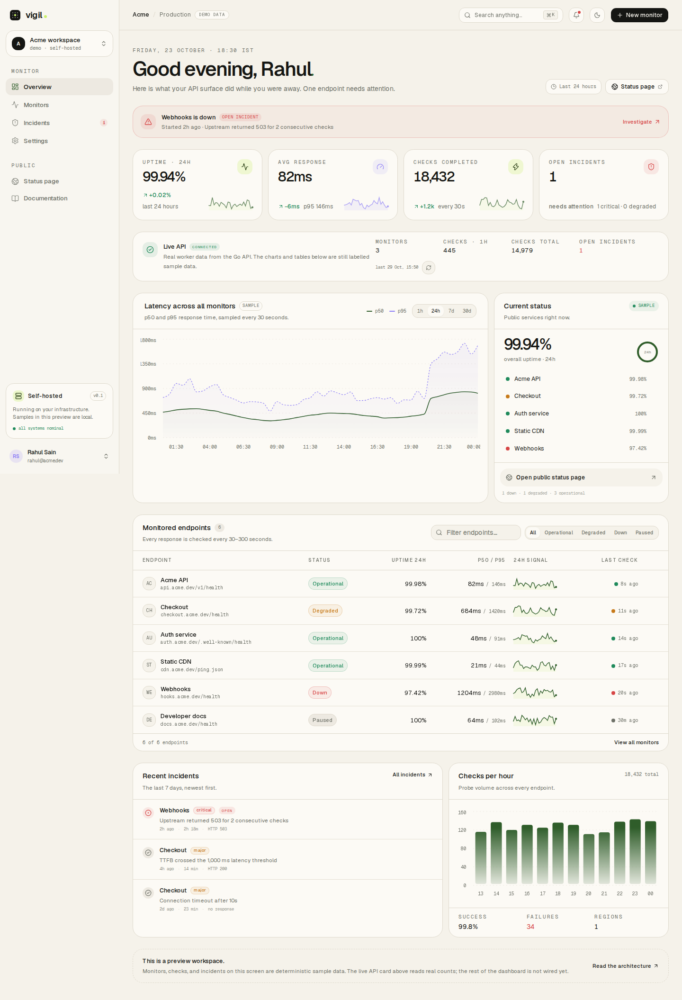

# Vigil — 7th Semester Project

**Know before they notice.**

Vigil is a self-hosted API performance and uptime monitor. This submission
includes the frontend and authentication MVP — a Next.js 16 dashboard, public
status page, Google-only Better Auth wiring, and a deterministic sample
workspace with a live API status card — plus a Go API, a standalone probe
worker, an Asynq/Brevo email alert notifier, PostgreSQL/Redis storage, and a
Docker Compose stack.



## Run the frontend demo

```bash
cd web
pnpm install
pnpm auth:init
cp .env.example .env.local
pnpm dev
```

Open [http://localhost:3000](http://localhost:3000). Google credentials are
optional for the sample workspace. If the Compose stack is already using port
3000, stop it first or run `pnpm dev --port 3001`.

Full setup, route map, scope notes, and screenshots are in
[web/README.md](web/README.md).

## Backend services

The `backend/` directory contains a Go 1.27 API, a standalone probe worker, an
alert notifier, a PostgreSQL 17 schema, a Redis 8-backed Asynq queue, and the
Compose services. The worker leases due monitors, measures HTTP latency phases,
writes checks, opens/resolves incidents, and enqueues deduplicated alert jobs.
The notifier sends Brevo transactional email and records delivery state in
PostgreSQL. The API exposes windowed uptime/latency rollups and persisted alert
attempts; the worker and notifier serve `/healthz` and `/readyz` on ports
`8081` and `8082`. Email delivery is disabled by default and needs Brevo
credentials. The dashboard's live API status card reads real counts; the rest
of the UI remains labelled sample data.

```bash
docker compose up --build
```

- Web preview: `http://localhost:3000`
- API: `http://localhost:8080`
- Worker health: `http://localhost:8081/healthz`
- Notifier health: `http://localhost:8082/healthz`
- PostgreSQL: `localhost:5433`
- Redis: `localhost:6380`

The Compose web service uses a local preview auth secret by default. For real
Google sign-in, export your credentials before starting it:

```bash
export BETTER_AUTH_SECRET="$(openssl rand -base64 32)"
export GOOGLE_CLIENT_ID="..."
export GOOGLE_CLIENT_SECRET="..."
docker compose up --build
```

Without credentials, the sample workspace and the labelled Google-not-configured
state remain available.

Backend tests:

```bash
cd backend
go test ./...
go vet ./...
```

See [backend/README.md](backend/README.md) for endpoints, worker configuration,
and limitations. A concise submission/report summary is in
[REPORT.md](REPORT.md).

## Scope

Built: landing page, dashboard, monitors, incidents, settings, public status
page, in-app docs, Better Auth Google wiring, local auth storage, Go API,
scheduled HTTP probe worker, PostgreSQL check/incident writes, windowed SQL
rollup endpoint, worker/notifier health endpoints, live API status card,
Asynq-backed Brevo email alerts with persisted delivery state, and Docker
Compose.

Next milestone: webhook alert delivery, broader Redis queue use/rate limiting,
and full UI-to-API wiring. Email delivery is implemented but disabled until
Brevo credentials are supplied; the UI labels its sample data and does not claim
the remaining services are running.

## Verification

```bash
cd web
pnpm lint
pnpm build

cd ../backend
go test ./...
go vet ./...

cd ..
docker compose config --quiet
```

MIT licensed. See [web/LICENSE](web/LICENSE).
