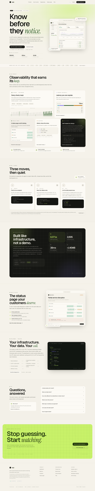
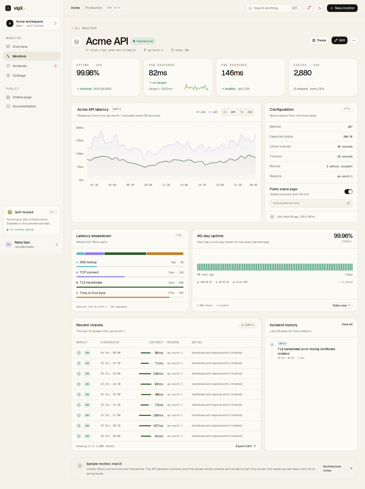
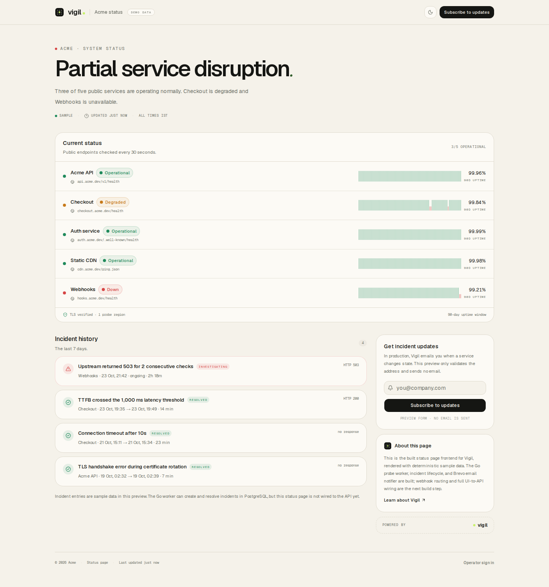
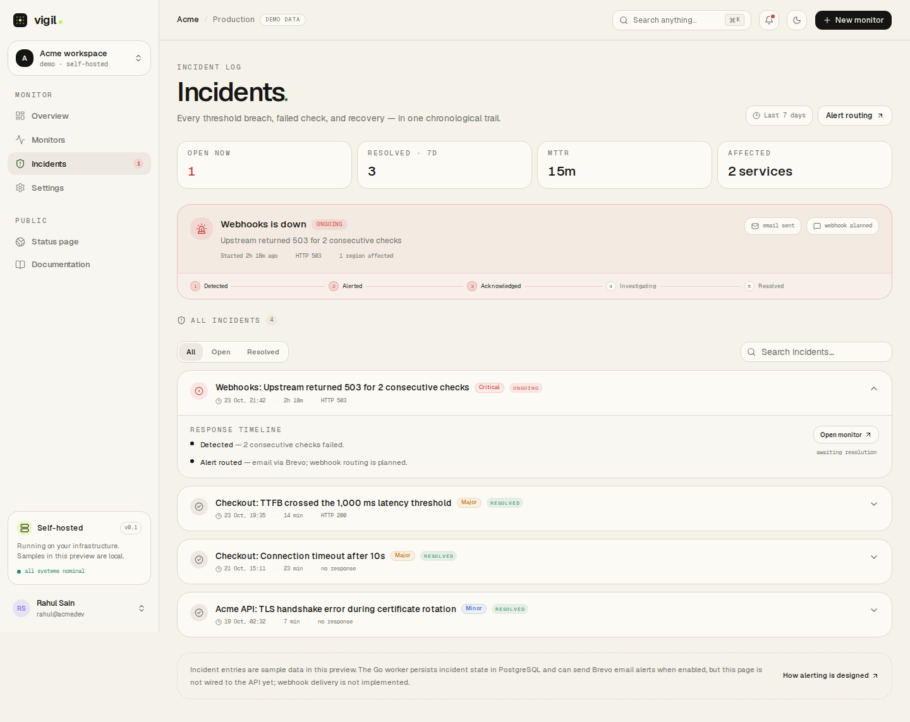
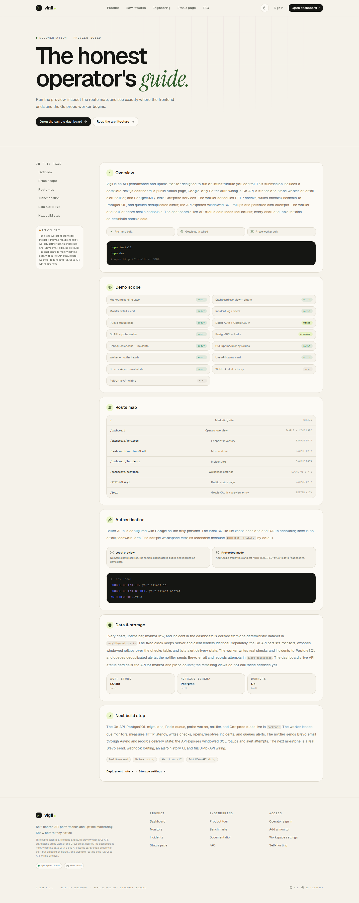
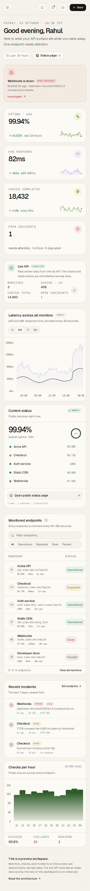
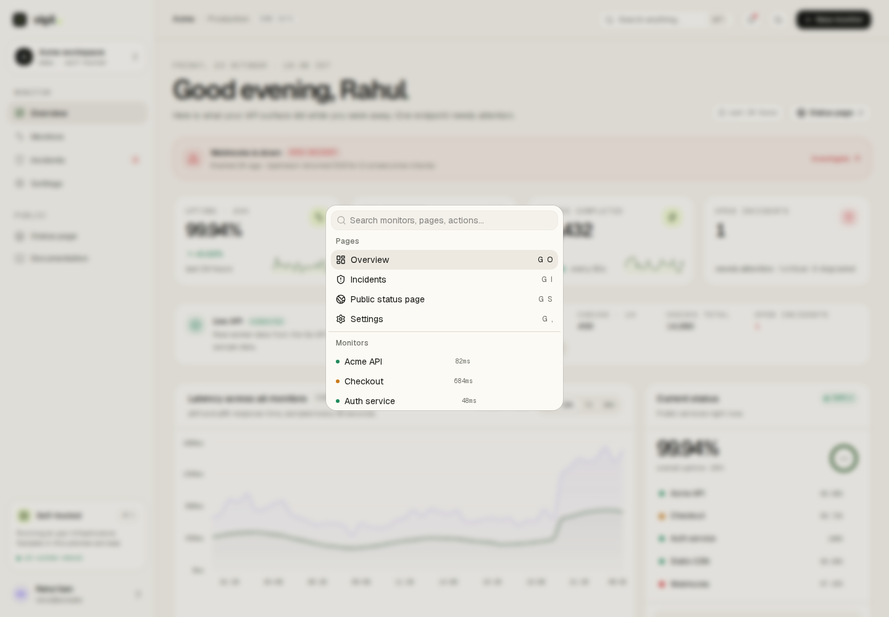

# Vigil

**Know before they notice.**

Vigil is a self-hosted API performance and uptime monitor. This repository is
the submission-ready frontend and authentication slice: a polished Next.js
dashboard, a public status page, Google-only Better Auth wiring, and a
deterministic sample workspace for every chart, table, and incident. A separate
Go API, standalone probe worker, and alert notifier add health/readiness
endpoints, scheduled HTTP checks, PostgreSQL check/incident writes, a Redis
Asynq queue, Brevo email delivery, and Docker Compose.

The dashboard is mostly deterministic sample data with a live API status card.
Email alert delivery is implemented but disabled by default; webhook delivery
and full UI-to-API wiring are the next build step.


## What is built

| Area | Status |
| --- | --- |
| Marketing landing page | Built |
| Dashboard overview, charts, monitor table | Built with sample data; overview includes a live API status card |
| Monitor inventory, detail, create, edit | Built; forms validate and show a preview toast only |
| Incident log, filters, timeline | Built with sample data |
| Public status page | Built with sample data |
| Google OAuth via Better Auth | Wired; activates when credentials are present |
| Local SQLite auth preview store | Built |
| Go API | Built: health/readiness, monitor storage, recent checks, incidents, alert attempts |
| PostgreSQL 17 schema | Built: monitors, partitioned checks, incidents, subscriptions, alert deliveries |
| Redis 8 wiring | Built: readiness and the Asynq `alerts` queue |
| Docker Compose stack | Built: web, API, worker, notifier, PostgreSQL, Redis |
| Probe worker and scheduled checks | Built: leases due monitors and writes results |
| SQL uptime/latency rollups | Built: windowed API endpoint; full dashboard wiring next |
| Worker health endpoints | Built: `/healthz` and `/readyz` on port `8081` |
| Email alert notifier | Built: Brevo HTTP API + Asynq retries; disabled by default |
| Notifier health endpoints | Built: `/healthz` and `/readyz` on port `8082` |
| Live API status card | Built: reads `/api/v1/probes` and `/api/v1/monitors` |
| Full UI-to-API data wiring | Next milestone |
| Webhook alert delivery | Next milestone |

## Screens

| Landing | Dashboard |
| --- | --- |
|  |  |

| Monitor detail | Public status page |
| --- | --- |
|  |  |

| Incidents | Documentation |
| --- | --- |
|  |  |

| Mobile dashboard | Command palette |
| --- | --- |
|  |  |

## Stack

- **Next.js 16.4.2** App Router, Cache Components, Partial Prefetching
- **React 19.3** with React Compiler
- **Tailwind CSS 4.3** and shadcn/ui 4.22 (`base-nova`, Base UI primitives)
- **EvilCharts** on Recharts for the area and bar charts
- **Motion** for quiet, reduced-motion-aware reveals
- **Better Auth 1.7** with Google as the only identity provider
- **better-sqlite3** for the local auth preview store
- **Go 1.27** standard-library API, probe worker, and alert notifier with `pgx`,
  `go-redis`, and Asynq
- **PostgreSQL 17** with a partitioned checks table and alert-delivery state
- **Redis 8** for readiness and the Asynq email queue
- **Brevo** transactional email HTTP API
- **Docker Compose** for the web, API, worker, notifier, PostgreSQL, and Redis
  services
- **Biome 2.4** for linting and formatting

## Run the preview

Prerequisites: Node.js 22+, pnpm 12+.

```bash
pnpm install
pnpm auth:init
cp .env.example .env.local
```

Generate a local auth secret and put it in `.env.local`:

```bash
openssl rand -base64 32
```

Set `BETTER_AUTH_SECRET` to that value. Google credentials are optional for the
sample demo. `NEXT_PUBLIC_API_URL` defaults to `http://localhost:8080` for the
live dashboard status card; set it before building if the Go API lives on a
different origin.

```bash
pnpm dev
```

Open [http://localhost:3000](http://localhost:3000). The dashboard is reachable
without signing in because `AUTH_REQUIRED=false` is the default.

### Google OAuth

1. Create an OAuth client in Google Cloud Console.
2. Add `http://localhost:3000/api/auth/callback/google` as an authorized
   redirect URI.
3. Put `GOOGLE_CLIENT_ID` and `GOOGLE_CLIENT_SECRET` in `.env.local`.
4. Restart the dev server.
5. Set `AUTH_REQUIRED=true` if you want `/dashboard` protected by the session
   proxy.

For a production build, rebuild after changing environment values so the
login page, auth config, and API URL pick them up.

The auth preview database is created at `.data/vigil-auth.db` by
`pnpm auth:init`. It is ignored by git. The Docker image runs the same
idempotent initializer on startup. To reset it, delete `.data` and run
`pnpm auth:init` again.

## Route map

| Route | Purpose |
| --- | --- |
| `/` | Landing page and product story |
| `/docs` | In-app documentation and scope notes |
| `/dashboard` | Operator overview (live API card + sample data) |
| `/dashboard/monitors` | Endpoint inventory |
| `/dashboard/monitors/new` | Create-monitor preview form |
| `/dashboard/monitors/[id]` | Monitor detail, latency, uptime, checks |
| `/dashboard/monitors/[id]/edit` | Edit-monitor preview form |
| `/dashboard/incidents` | Incident log and response timelines |
| `/dashboard/settings` | Workspace, auth, notifications, status, storage |
| `/status/[key]` | Public status page |
| `/login` | Google sign-in and sample-workspace entry |
| `/api/auth/[...all]` | Better Auth handler |

## Sample data

All demo product data lives in `src/lib/monitors.ts`. It uses a fixed clock
(`2026-10-23T18:30:00.000Z`) so server and client renders agree. The live API
status card is the exception: it reads `/api/v1/probes` and `/api/v1/monitors`.
The UI labels the sample workspace and the unbuilt persistence in the dashboard
footer, settings, status page, login, docs, and marketing copy.

The following interactions are intentionally local-only:

- Create and edit monitor forms validate and show a toast, then return to the
  sample list. Nothing is persisted.
- Pause/resume and monitor actions show an explanatory toast.
- Status-page subscriptions validate and show a preview confirmation. No email
  is sent.
- Notification toggles and workspace settings are presentation state.

## Backend services

The repository also contains a separate Go API, standalone probe worker, and
alert notifier under `backend/`: health/readiness endpoints, PostgreSQL 17
migrations, Redis 8 with an Asynq queue, scheduled HTTP checks, Brevo email
delivery, and a Docker Compose stack. The dashboard's live API status card reads
`/api/v1/probes` and `/api/v1/monitors`; the rest of the UI remains
deterministic sample data.

```bash
# from the repository root
docker compose up --build
```

- Web preview: `http://localhost:3000`
- API: `http://localhost:8080`
- Worker health: `http://localhost:8081/healthz`
- Notifier health: `http://localhost:8082/healthz`
- PostgreSQL: `localhost:5433`
- Redis: `localhost:6380`

The API exposes `/healthz`, `/readyz`, monitor storage, recent checks,
incidents, windowed SQL rollups, a probe summary, and persisted alert delivery
attempts at `/api/v1/alerts`. The worker is its own Compose service: it leases
due monitors, executes HTTP probes, writes the final retry result to
PostgreSQL, opens/resolves incidents, enqueues deduplicated alert jobs, and
serves `/healthz` and `/readyz` on port `8081`. The notifier consumes the
`alerts` queue, sends Brevo email, records delivery state, and serves health on
port `8082`. Email delivery is off unless `ALERT_EMAIL_ENABLED=true` and Brevo
credentials are provided. See `backend/README.md` for the full endpoint list,
environment variables, and migration notes.

## Verification

```bash
pnpm lint
pnpm build
```

The production build currently generates the marketing site, dashboard routes,
docs, login, public status routes, and the Better Auth handler. `pnpm build` is
the source of truth for the route list.

Backend smoke checks:

```bash
curl http://localhost:8080/readyz
curl http://localhost:8080/api/v1/monitors/<id>/rollup?window=24h
curl http://localhost:8081/healthz
curl http://localhost:8082/healthz
```

## Limitations

- The SQL rollup endpoint is not yet used by the dashboard charts; only the
  live status card calls the API for summary counts.
- No webhook alert delivery; the schema reserves the `webhook` channel.
- Email alerting is disabled by default and real Brevo sending needs
  `BREVO_API_KEY`, a verified sender, and recipients. The tested path used a
  local fake provider. Delivery is at-least-once.
- The frontend build does not connect to PostgreSQL or Redis. The optional
  Compose stack runs those services for the Go API, worker, and notifier.
- Only the live API status card is wired; the tables, charts, alert history,
  status page, and forms remain deterministic sample data.
- Worker and notifier health are exposed on ports `8081` and `8082`, but the
  dashboard does not show their status yet.
- Google OAuth cannot be exercised without real credentials.
- `AUTH_REQUIRED=true` redirects `/dashboard` to `/login` when no session cookie
  is present; full OAuth callback behavior still needs real Google credentials.
- Dashboard charts and incident data are deterministic samples, not production
  measurements.

## Next build step

1. Verify a real Brevo opened/resolved alert, then add webhook delivery and an
   alert-history UI.
2. Replace the remaining sample-data selectors with typed API calls and
   persisted forms, including the rollup endpoint.
3. Add authentication between the web app and the API.
4. Add rate limiting, broader Redis queue use, and worker throughput/error
   metrics beyond the health endpoints.

## Report sync notes

When updating the project report, keep these statements aligned with the built
UI:

- The submission is a **frontend and auth MVP** with a **Go API, standalone
  probe worker, and email alert notifier**.
- The landing-page benchmark band is explicitly labelled as report/reference
  figures, not live production numbers.
- Except for the live API status card, the dashboard, status page, and incident
  data are **deterministic sample data**.
- The worker writes real checks and incidents to PostgreSQL; the notifier sends
  deduplicated Brevo email alerts when enabled and persists delivery attempts.
  Only the live API status card is wired to the API.
- Windowed SQL rollups, worker/notifier health endpoints, and email alert
  delivery are built; webhook delivery and full UI-to-API wiring are the **next
  milestone**.
- Google is the only authentication provider; there is no email/password path.

## License

MIT. See [LICENSE](LICENSE).
